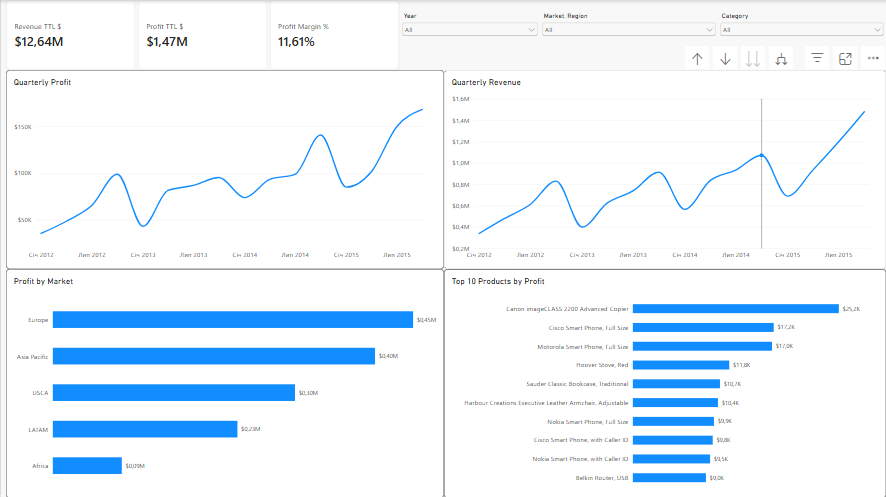
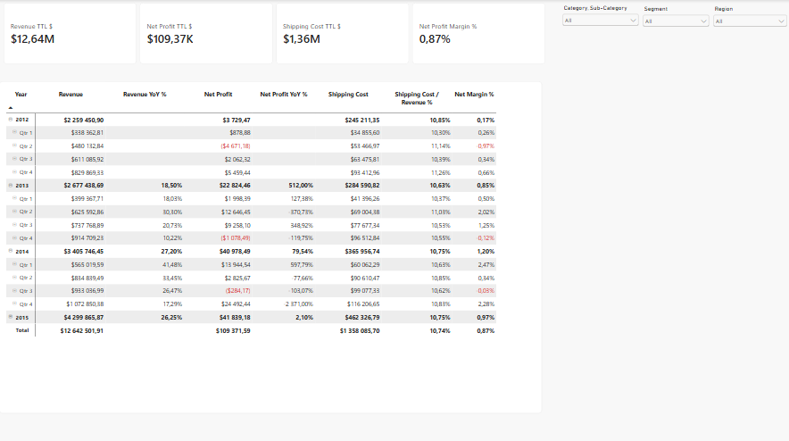
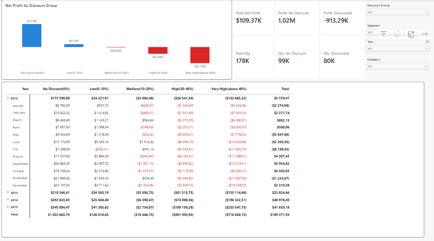
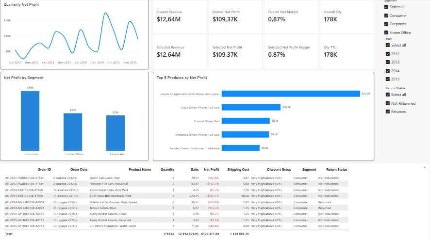
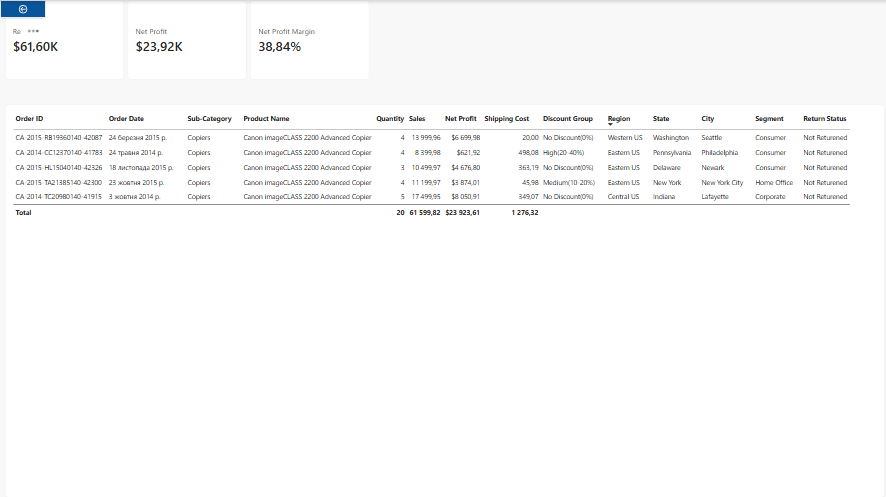

# Superstore Financial Analysis | Power BI

### Financial Performance, Profitability, Discount Analysis & Customer Segmentation

## Project Overview

This project presents an interactive, five-page Power BI report designed to evaluate the financial performance of a global retail distributor using the Superstore dataset.

The analysis focuses on revenue growth, profitability, shipping expenses, discount strategies, customer segments, and product-level performance.

The main objective is to identify factors associated with low profitability and translate financial data into actionable business recommendations.

**Tools:** Power BI Desktop, Power Query, DAX, Data Modeling

**Analysis Period:** 2012–2015

---

## Business Questions

The report addresses five key business questions:

1. How have revenue and profit changed over time?
2. How significantly do shipping costs affect profitability?
3. Which discount levels are associated with profitable or loss-making sales?
4. Which customer segments and products contribute the most to net profit?
5. How can transaction-level analysis support better financial decisions?

---
## Dashboard Preview

### Financial Overview


### Financial Analysis


### Discount Analysis


### Segment & Order Analysis


### Order Details


---
## Dashboard Structure

The Power BI report contains five interconnected pages.

### 1. Financial Overview

Provides a high-level overview of business performance.

**Key features:**
- Total Revenue, Total Profit, and Profit Margin KPIs
- Quarterly revenue and profit trends
- Profitability comparison across markets
- Top 10 products by profit
- Interactive year, market, and category filters

### 2. Financial Analysis

Focuses on financial performance after accounting for shipping expenses.

**Key features:**
- Revenue, Net Profit, Shipping Cost, and Net Profit Margin KPIs
- Yearly and quarterly financial performance
- Year-over-year revenue and net profit comparisons
- Shipping Cost / Revenue ratio
- Conditional formatting to highlight negative profitability

### 3. Discount Analysis

Examines the relationship between discount levels and profitability.

**Key features:**
- Net profit by discount group
- Profitability comparison between discounted and non-discounted sales
- Quantity sold with and without discounts
- Monthly and yearly breakdowns
- Interactive discount, segment, year, and category filters

**Discount groups:**
- No Discount (0%)
- Low (0–10%)
- Medium (10–20%)
- High (20–40%)
- Very High (>40%)

### 4. Segment & Order Analysis

Evaluates financial performance across customer segments and individual products.

**Key features:**
- Quarterly net profit trends
- Net profit by customer segment
- Top 5 products by net profit
- Overall vs. Selected KPI comparison
- Order-level transaction details
- Segment, year, and return-status filters

The Overall KPIs exclude the customer segment filter while retaining the relevant year and return-status context.

### 5. Order Details — Drill-through

Provides detailed information about selected products and their related transactions.

**Key features:**
- Product-specific financial KPIs
- Revenue, Net Profit, and Net Profit Margin
- Transaction-level details
- Shipping costs and discount groups
- Customer segment and return status
- Back navigation to the main report

---

## Key Financial Metrics

| Metric | Value |
|---|---:|
| Total Revenue | $12.64M |
| Total Profit | $1.47M |
| Profit Margin | 11.61% |
| Shipping Cost | $1.36M |
| Net Profit After Shipping | $109.37K |
| Net Profit Margin | 0.87% |
| Shipping Cost / Revenue | 10.74% |

### Metric Definitions

The dataset's `Sales` and `Profit` fields already reflect applied discounts.

Shipping expenses are deducted separately to calculate net profit after shipping.

```dax
Revenue TTL $ =
SUM(Fact_Orders[Sales])

Profit TTL $ =
SUM(Fact_Orders[Profit])

Shipping Cost TTL $ =
SUM(Fact_Orders[Shipping Cost])

Net Profit TTL $ =
[Profit TTL $] - [Shipping Cost TTL $]

Profit Margin % =
DIVIDE([Profit TTL $], [Revenue TTL $], 0)

Net Profit Margin % =
DIVIDE([Net Profit TTL $], [Revenue TTL $], 0)
```

**Important:** Net Profit in this project represents the dataset's Profit after deducting Shipping Cost. It should not be interpreted as accounting net income after all operating expenses and taxes.

---

## Key Business Insights

### 1. Revenue Growth Did Not Translate into Proportional Profit Growth

Revenue increased from approximately **$2.26M in 2012 to $4.30M in 2015**.

However, in 2015:
- Revenue grew by **26.25% YoY**.
- Net Profit increased by only **2.10% YoY**.
- Net Profit Margin declined from **1.20% in 2014 to 0.97% in 2015**.

This suggests that increasing sales volume alone was insufficient to sustain profitability improvements.

### 2. Shipping Expenses Significantly Reduced Profitability

Total Shipping Cost reached approximately **$1.36M**, representing **10.74% of Revenue**.

As a result, the reported Profit Margin of **11.61%** declined to a Net Profit Margin of only **0.87%** after shipping expenses.

Shipping cost management is therefore a critical area for further investigation.

### 3. High Discounts Were Associated with Substantial Losses

| Discount Group | Net Profit |
|---|---:|
| No Discount | +$1.02M |
| Low (0–10%) | +$126.02K |
| Medium (10–20%) | −$18.67K |
| High (20–40%) | −$301.99K |
| Very High (>40%) | −$718.65K |

Non-discounted sales generated approximately **$1.02M in net profit**, while discounted sales generated a combined loss of **$913.29K**.

Discount groups above 20% accounted for approximately **$1.02M in combined losses**.

These results indicate a strong association between deeper discounts and lower profitability. They do not, however, establish that discounts alone caused the losses.

### 4. Customer Segments Contributed Unevenly to Profit

The **Consumer** segment generated the highest absolute net profit, followed by **Home Office** and **Corporate**.

Additional analysis of revenue, order volume, and net profit margin is required to determine which segment is most efficient.

### 5. Product-Level Performance Varied Significantly

The **Canon imageCLASS 2200 Advanced Copier** was the leading product by both reported Profit and Net Profit after shipping.

Its Net Profit contribution was approximately **$23.8K**.

This highlights the importance of evaluating product-level profitability rather than focusing exclusively on sales revenue.

---

## Business Recommendations

Based on the findings, the following actions are recommended:

1. **Review shipping expenses.** Analyze shipping costs by region, product category, and shipping method to identify potential savings.
2. **Investigate high-discount transactions.** Identify products and categories generating losses at discount levels above 20%.
3. **Introduce profitability-based discount controls.** Evaluate whether discount approval thresholds should consider expected margins and shipping expenses.
4. **Monitor net profit margins.** Track profitability alongside revenue growth to detect margin deterioration.
5. **Compare customer segment efficiency.** Evaluate net profit margins and profit per order across customer segments.
6. **Investigate returned orders.** Compare the financial performance of returned and non-returned transactions.

These recommendations are based on descriptive analysis and should be validated through further investigation before implementation.

---

## Data Preparation & Modeling

### Power Query

Data preparation included:
- Cleaning and transforming source data
- Standardizing table and column names
- Handling missing values
- Creating address-related identifiers
- Preparing data for financial analysis

### Data Model

The project uses a star-schema-oriented data model with fact and dimension tables.

Key components include:
- `Fact_Orders`
- `Dim_Calendar`
- `Dim_Customers`
- `Dim_Returns`

A calendar table supports time intelligence calculations, while relationships between fact and dimension tables enable interactive filtering.

### DAX & Analytical Techniques

The report demonstrates:

- Financial KPI calculations
- Profitability and margin analysis
- `CALCULATE()` and filter context
- `KEEPFILTERS()` for discount analysis
- `REMOVEFILTERS()` for Overall vs. Selected comparisons
- `DATEADD()`, `PREVIOUSYEAR()`, and `PREVIOUSQUARTER()`
- `SAMEPERIODLASTYEAR()` for YoY comparisons
- Conditional formatting
- Top N product analysis
- Drill-through navigation

---

## Repository Files

| File | Description |
|---|---|
| `financial_report.pbix` | Power BI report, data model, and DAX calculations |
| `README.md` | Project documentation and business findings |

## How to Open the Report

1. Download `financial_report.pbix` from this repository.
2. Open the file using Microsoft Power BI Desktop.
3. Navigate through the report pages and use the available filters.
4. Explore the financial KPIs, discount analysis, customer segments, and order details.

---

## Project Value

This project demonstrates the ability to combine **financial analysis, data modeling, DAX, and interactive business intelligence reporting**.

Rather than focusing solely on visualization, the report emphasizes financial interpretation, identification of profitability risks, and evidence-based business recommendations.
